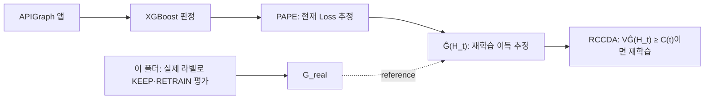
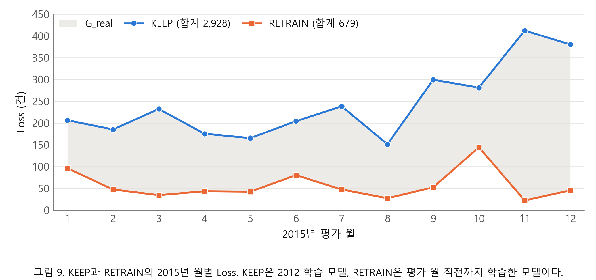
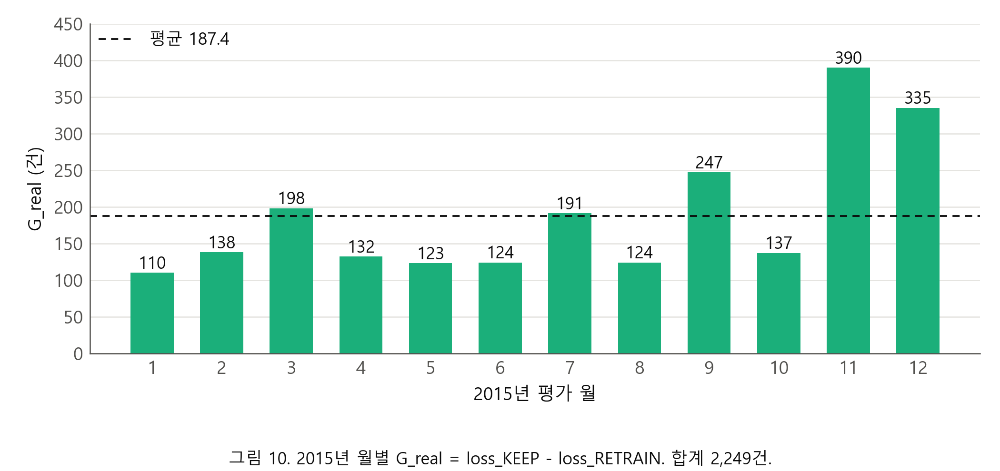
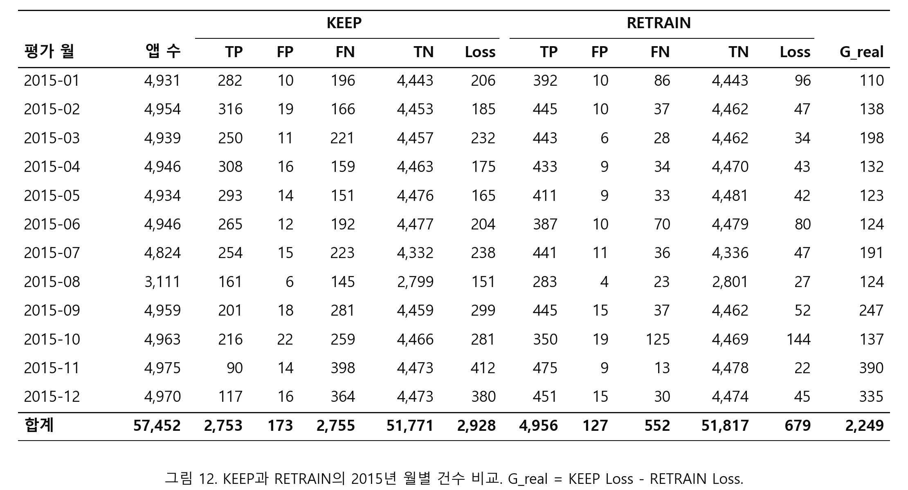

# APIGraph KEEP vs RETRAIN Gain 생성 인계

재학습 시 실제 이득 `G_real`을 2015년 12개월에 대해 계산한 결과다. `VĜ(H_t)` 수식을 수정할 때 비교 기준(reference)으로 쓴다.

## 1. 결과 요약

| 2015년 연간 | KEEP | RETRAIN |
|---|---|---|
| TP / FP | 2,753 / 173 | 4,956 / 127 |
| FN / TN | 2,755 / 51,771 | 552 / 51,817 |
| Loss (FN + FP) | 2,928 | 679 |
| Accuracy | 0.949 | 0.988 |
| F1 | 0.653 | 0.936 |
| Recall | 0.500 | 0.900 |

- `G_real` 합계 2,249, 월 평균 187.4, 중앙값 137.5, 최소 110(2015-01), 최대 390(2015-11).
- KEEP은 9월부터 FN이 TP보다 많고, Recall이 11월에 0.184까지 떨어진다.

## 2. 전체 흐름에서의 위치



`G_real`은 실제 라벨을 쓰는 평가 전용 값이다. 운영 입력(`gain_inputs.parquet`, `rccda_inputs.json`)에 넣지 않는다.

## 3. 실험 구조

| 항목 | 값 |
|---|---|
| 역할 | Train 2012 (30,533) / PAPE Source 2013-2014 (107,053) / Validation 2015 (57,452) / Test 2016-2018 (125,277, 실행 안 함) |
| 평가 단위 | 2015년 달력 월 12개, H=1 |
| 판정 | `xgb_score > 0.5`이면 악성 |
| Loss | FN + FP (λ 1:1). 연구 기준값이며 실제 비용이 아니다 |
| Gain | `G_real(m) = loss_KEEP(m) − loss_RETRAIN(m)`. 양수면 재학습이 이득 |

| 재학습 시점 (월말) | KEEP | RETRAIN 학습 데이터 | 학습 행 수 | 평가 월 |
|---|---|---|---|---|
| 2014-12 | 2012 모델 | 2012 ~ 2014-12 | 137,586 | 2015-01 |
| 2015-01 | 2012 모델 | 2012 ~ 2015-01 | 142,517 | 2015-02 |
| ... | 2012 모델 | ... | ... | ... |
| 2015-11 | 2012 모델 | 2012 ~ 2015-11 | 190,068 | 2015-12 |

- **KEEP:** PAPE와 같은 2012 학습 XGBoost를 고정한다. 12개월 값이 PAPE `actual_*`와 모두 일치한다.
- **RETRAIN:** 연구실 `train_stage`와 같은 절차로 매월 처음부터 새로 학습한다. Feature 벡터 그룹 단위로 fit 60%, early stopping 20%, holdout 20%로 나눠 트리 수를 정한 뒤, 학습 데이터 전체로 다시 학습한다.
- **XGBoost 설정:** binary:logistic, hist, CPU, 최대 1000 trees, lr 0.05, max_depth 5, early stopping 40, seed 11, n_jobs 2.

## 4. 폴더 구조

```
apigraph_gain/
├─ README.md
├─ code/
│  ├─ keep_monthly.py     KEEP 12개월 평가, PAPE actual과 검산
│  ├─ retrain_monthly.py  RETRAIN 12개월 학습·평가
│  ├─ gain_monthly.py     G_real 계산
│  └─ plot_figures.py     그림 12개 생성
├─ results/
│  ├─ keep_monthly.csv
│  ├─ retrain_monthly.csv
│  └─ gain_monthly.csv
├─ figures/               그림 1~12 (PNG)
├─ presentation/          11.09 미팅 발표 자료 초안 (PPTX)
└─ baseline_1102/         11/2 기준 모델과 손실표 (이전 역할 기준)
```

`baseline_1102/`는 Source 2013 / Validation 2014 / Test 2015~2018 역할과 다른 모델(300 trees, lr 0.1, depth 6, seed 42)을 쓴다. PAPE 값과 결합하지 않는다.

## 5. 결과 그림







| 번호 | KEEP | 번호 | RETRAIN |
|---|---|---|---|
| 1 | [confusion matrix](figures/1_KEEP_confusion_matrix.png) | 5 | [confusion matrix](figures/5_RETRAIN_confusion_matrix.png) |
| 2 | [월별 Loss](figures/2_KEEP_월별_Loss.png) | 6 | [월별 Loss](figures/6_RETRAIN_월별_Loss.png) |
| 3 | [월별 Accuracy·F1·Recall](figures/3_KEEP_월별_지표.png) | 7 | [월별 Accuracy·F1·Recall](figures/7_RETRAIN_월별_지표.png) |
| 4 | [월별 TP·FN·FP·TN](figures/4_KEEP_월별_confusion_matrix.png) | 8 | [월별 TP·FN·FP·TN](figures/8_RETRAIN_월별_confusion_matrix.png) |

그림 11은 [연간 비교표](figures/11_KEEP_RETRAIN_연간_비교표.png)다. KEEP과 RETRAIN 그림은 축 범위가 같다.

## 6. 재현

**Git 밖에서 받을 입력**

| 입력 | 내용 |
|---|---|
| `train.npz` | ADAPT APIGraph NPZ (revision 17f3303), SHA256 `0943985e072fb00bb1610cf8ea4e837c53bfc4a2203ab30bf29fb75d6be78aa9` |
| `val.npz` | SHA256 `80ee5c01114ad055d95dee5c4d2b045b88958dcdbbf56803eacbd15326e46e2b` |
| `test.npz` | SHA256 `cb1d892434b7b194ca568c5328aa7ba14f3ab6bc8f43b473252ea4a337d5c638` |
| `model/model.json` | 정필수 연구실 PAPE v8 인계 묶음(`pape_outputs`), SHA256 `fd463badc8580d9296edaab9818186a76c3f7dd579b9166a314994792b031813` |
| `review/monthly_comparison.csv` | 같은 인계 묶음의 PAPE 월별 추정·실제 값 |

인계 코드는 [drone-health-retraining](https://github.com/hui-jeong/drone-health-retraining)의 `feature/pape`(PAPE)와 `feature/modelXGBoost`(학습 절차)에 있다. 데이터, 모델, Parquet, ZIP은 Git에 올리지 않는다.

**실행 (이 폴더 기준)**

```
python -I code/keep_monthly.py <npz 폴더>/test.npz <model.json> <monthly_comparison.csv> results/keep_monthly.csv
python -I code/retrain_monthly.py <npz 폴더> results/retrain_monthly.csv
python -I code/gain_monthly.py results/keep_monthly.csv results/retrain_monthly.csv results/gain_monthly.csv
python -I code/plot_figures.py results figures
```

- **소요 시간:** RETRAIN은 CPU에서 약 25분, 나머지는 1분 안팎이다.
- **환경:** Python 3.13.12, xgboost 3.3.0, numpy 2.4.4, scikit-learn 1.9.0, pandas 3.0.3, matplotlib 3.10.9. 그림은 Malgun Gothic 글꼴을 쓴다.
- **코드 검산:** KEEP은 PAPE `actual_*` 일치, RETRAIN은 2012 트리 수 536 재현과 학습 행 수·마지막 월, Gain은 월·앱 수·악성 수 일치를 확인하고 저장한다.

## 7. 가정과 한계

| 항목 | 내용 | 영향 |
|---|---|---|
| 라벨 확정 시점 | 매월 말 확정으로 가정했다. 정필수 연구실 미확인 | 연간 확정이면 2015년 RETRAIN은 2012~2014-12 모델 1개가 된다 |
| 학습 데이터 범위 | RETRAIN에 2013-2014를 포함했다. 정필수 연구실 미확인 | 빼면 2015-01 RETRAIN이 KEEP과 같은 2012 데이터로 학습된다 |
| KEEP 고정 | 2012 모델을 재학습 없이 유지한 경로만 평가한다 | 재학습 직후의 작은 Gain을 포함하지 않는다. `G_real`과 같은 달 KEEP Loss의 Pearson 상관이 0.93이다 |
| 중복 행 | 원행 유지 정책을 쓴다. 같은 Feature 벡터가 학습과 평가에 함께 있을 수 있다 | Gain이 부풀었을 수 있다. 영향은 측정하지 않았다 |
| 트리 상한 | 12개월 중 7개월이 상한 1000에서 멈췄다. 연구실 설정을 유지했다 | 상한을 늘리면 Loss가 달라질 수 있다 |
| 실행 환경 | 로컬 xgboost 3.3.0, 연구실 3.4.1. 2012 학습은 트리 수와 2015 예측이 완전히 같았다 | 더 큰 학습 데이터에서의 동일성은 확인하지 않았다 |
| 반복 | seed 11로 1회만 학습했다. RETRAIN 모델은 저장하지 않았다 | seed 영향은 측정하지 않았다. 다른 분석에 모델이 필요하면 다시 학습한다 |
| 1,159개 Feature | Chen 논문 부록 A는 DREBIN 특징의 분산 기준 선택으로, ADAPT는 API 의미 군집으로 설명한다 | 두 설명의 일치를 검증하지 않았다. 전부 API cluster라고 쓰지 않는다 |

"API Graph 실행"은 APIGraph 데이터로 모델을 학습하고 평가하는 것으로 해석했다. relation graph와 embedding은 실행하지 않았다.

## 8. PAPE 값과 연결하기

- **입력 파일:** `validation/rccda_inputs.json` 또는 `gain_inputs.parquet`. seed 하나와 방법(uniform 또는 DRE) 하나를 골라 월별 1행을 쓴다. 여러 seed를 독립 관측으로 합치지 않는다.
- **시점 맞추기:** 2015-m월 PAPE 추정값은 다음 달부터 쓸 수 있으므로 `G_real(m+1)`과 짝짓는다. 2015-01 `G_real`에는 대응하는 PAPE 값이 없어 **11쌍**이 나온다.
- **모델 일치:** PAPE 값은 KEEP 모델 기준이다. 탐지기가 바뀌면 Source와 Target을 재채점하고 보정기를 다시 학습해야 한다.
- **주의:** PAPE는 10~12월 Loss를 낮게 추정한다.

| 2015년 | 실제 Loss | PAPE uniform | PAPE DRE (seed 평균) |
|---|---|---|---|
| 10월 | 281 | 197 | 210 |
| 11월 | 412 | 238 | 266 |
| 12월 | 380 | 266 | 285 |

**예비 확인 (11쌍, 앱당 기준).** `Ĝ = Kp(f_t − 최저 f) + Kd(f_t − f_{t−1})`, `Kp=1`, `Kd=0.5`로 계산했다. 표본이 작고 파라미터를 조정하지 않은 값이라 결론으로 쓰지 않는다.

| 판단 시점 입력 → 다음 달 `G_real` | Pearson | Spearman |
|---|---|---|
| 실제 Loss | +0.64 | +0.61 |
| PAPE DRE Loss | +0.21 | +0.38 |
| PAPE uniform Loss | −0.06 | +0.08 |
| 실제 Loss로 계산한 `Ĝ` | +0.58 | +0.57 |
| PAPE DRE로 계산한 `Ĝ` | +0.09 | +0.24 |
| PAPE uniform으로 계산한 `Ĝ` | −0.15 | +0.08 |

## 9. 후속 작업

| 작업 | 내용 |
|---|---|
| `VĜ(H_t)` 수식 수정 | PAPE로 얻을 수 있는 입력으로 수식을 고치고 `G_real`과 비교한다 |
| 라벨 가정 확정 | 7절의 라벨 시점과 학습 범위를 정필수 연구실과 확정한다. 달라지면 RETRAIN을 다시 실행한다 |
| RCCDA 통합 | virtual queue와 정책을 구현하고, 재학습 후 KEEP이 바뀌는 경로를 평가한다 |
| Test 실행 | 2016-2018 Test와 연간 Source 갱신을 통합 단계에서 실행한다 |
